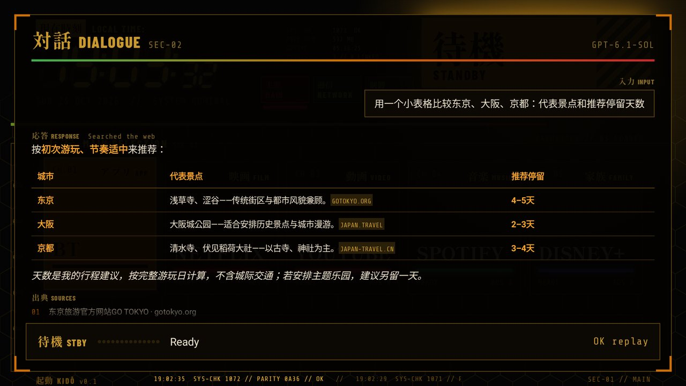
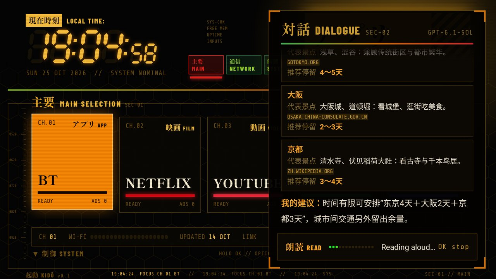
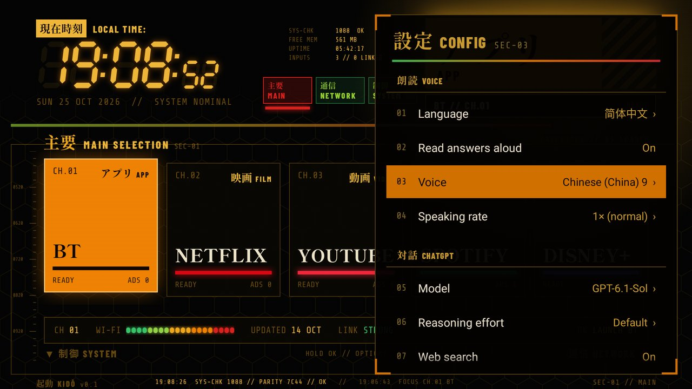
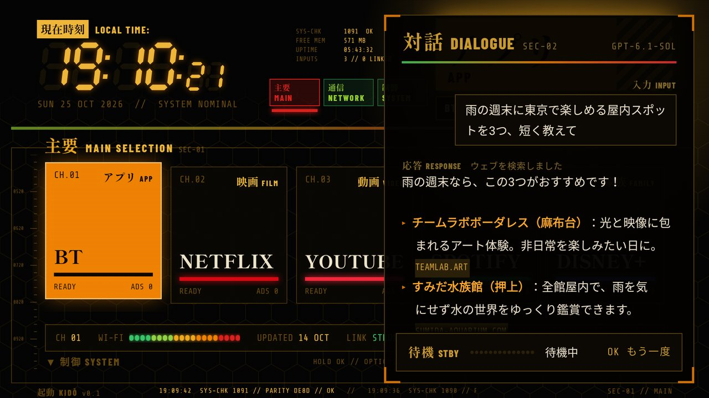

# 対話 Taiwa

**Press the Assistant button on your Android TV remote, talk, and ChatGPT answers in a side panel
over whatever is on screen, then reads a short spoken version aloud in your language.**
Styled to sit next to the [KIDŌ](https://github.com/glidiandev/kido) launcher; built on the tools
and lessons of [CleanYourTV](https://github.com/Gathin23/cleanyourtv).

> 中文说明：[README.zh-CN.md](README.zh-CN.md)



| Narrow panel | Settings | Japanese UI |
|---|---|---|
|  |  |  |

## Get it on your TV with one prompt

TVs differ: which button the remote sends, which system app owns it, where the microphone audio goes.
So instead of a one-size-fits-all installer, Taiwa ships its source plus **[PROMPT.md](PROMPT.md)**: paste
it into [Claude Code](https://claude.com/claude-code) (or another coding agent with a shell) on the
computer that will run the relay, fill in your TV model and language, and the agent investigates your
TV, builds and installs everything, signs you in to ChatGPT (you type your password yourself, in your
browser), and verifies each step with screenshots from the TV.

The computer does three jobs: it builds the TV app, runs **taiwa-relay** (speech-to-text with
whisper.cpp, the ChatGPT sign-in, the conversation), and keeps running in the background so the TV
can reach it. macOS on Apple Silicon is tested; Linux and Windows are supported by the code but untested.

## What it does

- **Assistant button → listen → answer.** The panel slides in from the right over any app (a playing
  video keeps playing), listens, endpoints your speech automatically (or press OK), and streams the answer.
- **One conversation per panel.** Every press while the panel is open is a follow-up in the same session.
  Back closes the panel and ends the session.
- **Full ChatGPT answers**: Markdown, tables (cards in the narrow panel, a real grid in wide mode),
  code blocks, web search with sources, and the model's reasoning summary while it thinks.
- **Spoken version.** After each answer a fast model rewrites it as two to five spoken sentences, and
  the TV reads them with its own text-to-speech while other audio is ducked. OK stops or replays it.
- **Your language.** One setting drives speech recognition, the answer language and the voice
  (13 languages in `relay/taiwa_relay/languages.py`); the panel's own text is English, 简体中文 or 日本語.
- **Settings on the remote** (▶ in the narrow panel): language, read-aloud on/off, voice with live
  preview, speaking rate, model, reasoning effort, web search, relay address (found automatically).
- **Finds its relay again.** The relay advertises itself on the LAN (`_taiwa._tcp`); if the computer's
  IP changes, the TV finds it and re-sends the question.

## How it works

```
remote ──Assistant button + mic (ATVV over BLE)──► Android TV Remote Service ──ACTION_ASSIST──► Taiwa panel
                                                     injects the remote's audio into the     │ 16 kHz PCM,
                                                     assistant's AudioRecord                 │ relay token
                                                                                              ▼
                                      your computer (same LAN): taiwa-relay :8787
                                        ├─ whisper.cpp (local speech-to-text, nothing leaves the LAN)
                                        └─ api.openai.com/v1/responses through Sign in with ChatGPT
```

On many Google-certified remotes the Assistant button is **not a key**: it is a message on Google's
voice-over-BLE service, which only the preinstalled *Android TV Remote Service* may read, and the
remote's microphone only reaches an app through that service. Taiwa therefore registers as the TV's
default assistant and lets the system hand it both. The details, and how the agent checks your TV,
are in [docs/how-it-works.md](docs/how-it-works.md).

ChatGPT access uses **[Sign in with ChatGPT](https://developers.openai.com/siwc/token-sharing-open-source)**,
the official way for open-source and locally hosted apps to use your ChatGPT plan: no API key, no
password stored anywhere, tokens kept on your computer. Step by step:
[docs/sign-in-with-chatgpt.md](docs/sign-in-with-chatgpt.md).

## Requirements

- An **Android TV / Google TV 11 or newer** with a voice remote (Assistant or microphone button), with
  developer options and network debugging turned on. The remote's voice path must reach a third-party
  assistant; the prompt checks this first and stops if your TV can't.
- A **computer on the same network** that stays on: macOS 14+ on Apple Silicon (tested), or Linux /
  Windows (untested). About 1 GB of disk for whisper.cpp and its model, plus JDK 17 (or 21) and the Android SDK
  to build the app.
- A **ChatGPT account** whose plan can be used through Sign in with ChatGPT. Answers count against
  your plan's usage limits (on Plus, the five-hour limit is shared with other apps).
- Optional: the [KIDŌ](https://github.com/glidiandev/kido) launcher, and [CleanYourTV](https://github.com/Gathin23/cleanyourtv)
  if you want to debloat the TV as well.

## Remote keys

| Key | In the panel |
|---|---|
| Assistant | speak: opens the panel, asks a follow-up, or interrupts an answer |
| OK | stop listening now; while reading aloud stop; otherwise replay (or fetch) the spoken version |
| ▲ ▼ / CH+ CH− | scroll |
| ◀ | wide mode: nearly full screen, smaller text, tables as a grid |
| ▶ | back to the narrow panel; in the narrow panel: settings |
| Back | cancel listening, otherwise close the panel and end the conversation |

## Manual setup (if you'd rather not use the prompt)

```bash
# on the computer
uv tool install ./relay                      # or a venv + pip install ./relay
brew install whisper-cpp                     # macOS; see PROMPT.md for Linux/Windows
taiwa-relay fetch-model                      # ~550 MB, SHA-256 verified
taiwa-relay login                            # browser on this computer: sign in, allow "Use your ChatGPT plan"
taiwa-relay models && taiwa-relay set-model <slug>
taiwa-relay set-language en-US               # zh-CN, ja-JP, …
taiwa-relay install-service                  # start at login
taiwa-relay doctor

# the TV app (JDK 17 + Android SDK 34)
cd android && ./gradlew assembleRelease
adb connect <tv-ip>:5555
adb install -r -g app/build/outputs/apk/release/app-release.apk
adb shell am broadcast -n io.github.nial4.taiwa/.ConfigReceiver --es url http://<computer-ip>:8787 --es token "$(taiwa-relay token)"
adb shell settings put secure assistant io.github.nial4.taiwa/.ChatActivity
```

Whether the last line is enough depends on your TV. On the TCL tested here the Android TV Remote
Service also had to be enabled (`adb shell pm enable com.google.android.tv.remote.service`); see
[docs/how-it-works.md](docs/how-it-works.md).

## Privacy and security

- **Audio** is recorded only after you press the Assistant button and is transcribed on your computer;
  it is not stored.
- **Text** of your questions, the conversation of the open panel, the answers and web searches go to
  OpenAI under your account (`store: false`). Conversations live in the relay's memory and are dropped
  when you close the panel (or after 30 idle minutes).
- **"Online" TTS voices** send the spoken version to Google for synthesis; offline voices don't.
- **ChatGPT tokens** stay in `~/.config/taiwa/credentials.json` (owner-only; `%APPDATA%\taiwa` on Windows) on your computer; the TV
  never sees them. `taiwa-relay logout` revokes them; you can also disconnect "Taiwa" in ChatGPT's settings.
- The TV talks to the relay over plain HTTP on your LAN with a random **relay token**; anyone on your
  LAN without the token gets HTTP 401. Don't expose port 8787 to the internet.
- The app's permissions: `INTERNET` (the relay only) and `RECORD_AUDIO`. Its config receiver only
  accepts commands from `adb shell` (`android.permission.DUMP`).

## Limitations

- Image generation, code interpreter and file analysis are not available through Sign in with ChatGPT
  plan usage (only web search and developer-defined tools are); its OSS flow is a preview and may change.
- One press of the Assistant button per spoken turn (that is when the remote's microphone is routed to Taiwa).
- Tested on one TV so far (below). Other TVs and remotes may route the button or microphone differently;
  the prompt finds out and tells you.

## Tested on

| TV | Android | Remote | Relay computer |
|---|---|---|---|
| TCL 50P635 (Japan, 2022) | Android TV 11 | TCL RC610 J4 (ATVV) | Mac mini M4, macOS 27 |

Another TV working (or not)? An issue or a pull request adding a row is very welcome.

## Repository

| Path | What |
|---|---|
| [`PROMPT.md`](PROMPT.md) / [`PROMPT.zh-CN.md`](PROMPT.zh-CN.md) | the one prompt that sets everything up |
| [`AGENTS.md`](AGENTS.md) | a map of the code for coding agents |
| [`android/`](android/) | the TV app (Java, no AndroidX, ~190 KB) |
| [`relay/`](relay/) | taiwa-relay (Python: FastAPI, httpx) |
| [`docs/`](docs/) | how it works, Sign in with ChatGPT, troubleshooting, images |

## Credits

- [KIDŌ](https://github.com/glidiandev/kido) by Glidian, whose look the panel follows, and
  [CleanYourTV](https://github.com/Gathin23/cleanyourtv) by Gathin, whose agent-driven approach and
  tools this builds on. Both MIT.
- Fonts under the SIL Open Font License, the same families KIDŌ uses: [Shippori Mincho B1](https://fonts.google.com/specimen/Shippori+Mincho+B1)
  (subset), [Barlow Condensed](https://fonts.google.com/specimen/Barlow+Condensed) and
  [Share Tech Mono](https://fonts.google.com/specimen/Share+Tech+Mono). Licenses in `android/app/src/main/assets/licenses/`.
- [whisper.cpp](https://github.com/ggml-org/whisper.cpp) for local speech-to-text, and OpenAI's
  [Sign in with ChatGPT](https://developers.openai.com/siwc) for plan access.

Taiwa is an independent project, not affiliated with or endorsed by OpenAI, Google, TCL, Glidian or
Gathin. ChatGPT is a trademark of OpenAI; Android TV and Google TV are trademarks of Google.

## License

MIT. See [LICENSE](LICENSE).
