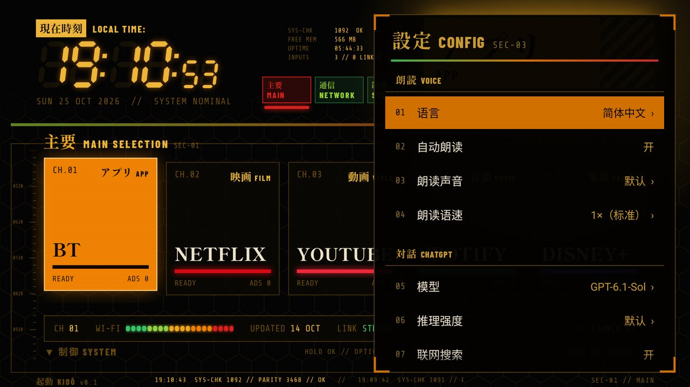

# 対話 Taiwa

**按下 Android TV 遥控器上的 Assistant 键说话，ChatGPT 的回答会出现在屏幕侧边的面板里（不打断正在播放的内容），
然后用你的语言把一段简短的口语版本读出来。**
界面风格与 [KIDŌ](https://github.com/glidiandev/kido) 启动器保持一致；思路和工具基于
[CleanYourTV](https://github.com/Gathin23/cleanyourtv)。

> English: [README.md](README.md)


| 窄面板 | 设置（中文界面） | 日语界面 |
|---|---|---|
|  |  |  |

## 一个 prompt 装到你的电视上

每台电视都不一样：遥控器发出的是什么信号、哪个系统应用接管了这个键、麦克风的声音最后送到了哪里。
所以 Taiwa 不提供“一键安装包”，而是提供源码加一份 **[PROMPT.zh-CN.md](PROMPT.zh-CN.md)**：在要运行中继服务器的那台电脑上，
把它粘贴进 [Claude Code](https://claude.com/claude-code)（或其他能执行 shell 命令的编程 agent），填上你的电视型号和语言，
agent 就会去调查你的电视，编译并安装所有东西，帮你完成 ChatGPT 登录（密码由你自己在浏览器里输入），
并且每一步都用电视截图来确认。

这台电脑承担三件事：编译电视端 App；运行 **taiwa-relay**（用 whisper.cpp 做语音识别、保管 ChatGPT 登录、管理对话）；
常驻后台让电视随时能连上。已在 Apple Silicon 的 macOS 上测试；Linux 和 Windows 代码层面支持，但未实测。

## 功能

- **Assistant 键 → 听 → 回答。** 面板从右侧滑入，覆盖在任何应用之上（正在播放的视频继续播放），
  自动判断你说完了（也可以按 OK），然后流式显示回答。
- **一个面板就是一次对话。** 面板打开期间再按 Assistant，就是在同一个会话里追问；按返回键关闭面板并结束会话。
- **完整的 ChatGPT 回答**：Markdown、表格（窄面板里显示为卡片，宽屏模式显示为真正的表格）、代码块、
  带来源的联网搜索，以及模型思考时的推理摘要。
- **口语版本朗读。** 每个回答之后，一个快速模型把它改写成 2～5 句口语，由电视自带的 TTS 读出来，
  期间其他声音会自动压低。OK 键停止或重播。
- **你的语言。** 一个设置同时决定语音识别、回答语言和朗读声音（`relay/taiwa_relay/languages.py` 中有 13 种语言）；
  面板本身的界面文字支持 English、简体中文、日本語。
- **遥控器上就能改设置**（窄面板里按 ▶）：语言、自动朗读开关、声音（带实时试听）、语速、模型、推理强度、
  联网搜索、中继地址（可自动发现）。
- **自动重新找到中继。** 中继会在局域网里广播自己（`_taiwa._tcp`）；电脑 IP 变了，电视会自己找到它并重新发送问题。

## 工作原理

```
遥控器 ──Assistant 键 + 麦克风（BLE 上的 ATVV）──► Android TV Remote Service ──ACTION_ASSIST──► Taiwa 面板
                                                     把遥控器的音频注入到                       │ 16 kHz PCM、
                                                     助理应用的 AudioRecord                     │ 中继令牌
                                                                                                ▼
                                      你的电脑（同一局域网）：taiwa-relay :8787
                                        ├─ whisper.cpp（本地语音识别，音频不出局域网）
                                        └─ 通过 Sign in with ChatGPT 访问 api.openai.com/v1/responses
```

在很多 Google 认证的遥控器上，Assistant 键**根本不是一个按键**：它是 Google 的 BLE 语音服务里的一条消息，
只有预装的 *Android TV Remote Service* 才能读取，遥控器的麦克风也只能经由这个服务送到应用里。
所以 Taiwa 把自己注册为电视的默认助理，让系统把按键和麦克风一起交给它。细节以及 agent 如何检查你的电视，
见 [docs/how-it-works.zh-CN.md](docs/how-it-works.zh-CN.md)。

ChatGPT 的访问使用 **[Sign in with ChatGPT](https://developers.openai.com/siwc/token-sharing-open-source)**，
这是 OpenAI 官方为开源和本地托管应用提供的、使用你自己 ChatGPT 套餐的方式：不需要 API Key，任何地方都不保存密码，
令牌只留在你的电脑上。一步一步的说明：[docs/sign-in-with-chatgpt.zh-CN.md](docs/sign-in-with-chatgpt.zh-CN.md)。

## 需要准备

- 一台 **Android TV / Google TV 11 或更新版本**的电视，配有语音遥控器（Assistant 键或麦克风键），
  并已打开开发者选项和网络调试。遥控器的语音通路必须能交给第三方助理；prompt 会先检查这一点，不行就会停下来告诉你。
- 一台**同一网络里常开的电脑**：Apple Silicon 上的 macOS 14+（已测试），或 Linux / Windows（未测试）。
  whisper.cpp 和模型约需 1 GB 磁盘，编译 App 还需要 JDK 17（或 21）和 Android SDK。
- 一个其套餐可以通过 Sign in with ChatGPT 使用的 **ChatGPT 账号**。回答会计入你套餐的用量限制
  （Plus 的 5 小时限额与其他应用共享）。
- 可选：[KIDŌ](https://github.com/glidiandev/kido) 启动器；如果还想给电视精简系统，可以用 [CleanYourTV](https://github.com/Gathin23/cleanyourtv)。

## 遥控器按键

| 按键 | 面板中的作用 |
|---|---|
| Assistant | 说话：打开面板、追问，或打断正在生成的回答 |
| OK | 立即结束录音；朗读中则停止；否则重播（或获取）口语版本 |
| ▲ ▼ / CH+ CH− | 滚动 |
| ◀ | 宽屏模式：几乎全屏，字更小，表格显示为网格 |
| ▶ | 回到窄面板；在窄面板中：打开设置 |
| 返回 | 取消录音；否则关闭面板并结束对话 |

## 手动安装（如果你不想用 prompt）

```bash
# 在电脑上
uv tool install ./relay                      # 或者用 venv + pip install ./relay
brew install whisper-cpp                     # macOS；Linux/Windows 见 PROMPT.zh-CN.md
taiwa-relay fetch-model                      # 约 550 MB，校验 SHA-256
taiwa-relay login                            # 在这台电脑的浏览器里登录，并允许 "Use your ChatGPT plan"
taiwa-relay models && taiwa-relay set-model <slug>
taiwa-relay set-language zh-CN               # en-US、ja-JP……
taiwa-relay install-service                  # 登录后自动启动
taiwa-relay doctor

# 电视端 App（JDK 17 + Android SDK 34）
cd android && ./gradlew assembleRelease
adb connect <电视IP>:5555
adb install -r -g app/build/outputs/apk/release/app-release.apk
adb shell am broadcast -n io.github.nial4.taiwa/.ConfigReceiver --es url http://<电脑IP>:8787 --es token "$(taiwa-relay token)"
adb shell settings put secure assistant io.github.nial4.taiwa/.ChatActivity
```

最后一行够不够取决于你的电视。在这里测试的 TCL 上，还需要启用 Android TV Remote Service
（`adb shell pm enable com.google.android.tv.remote.service`）；见 [docs/how-it-works.zh-CN.md](docs/how-it-works.zh-CN.md)。

## 隐私与安全

- **音频**只在你按下 Assistant 键之后录制，在你的电脑上转写，不会保存。
- 你问题的**文字**、当前面板内的对话、回答和联网搜索会以你的账号发送给 OpenAI（`store: false`）。
  对话只保存在中继的内存里，关闭面板时（或闲置 30 分钟后）即丢弃。
- **“在线” TTS 声音**会把口语版本发送给 Google 合成；离线声音不会。
- **ChatGPT 令牌**保存在你电脑上的 `~/.config/taiwa/credentials.json`（仅所有者可读；Windows 上在 `%APPDATA%\taiwa`）；电视永远看不到它们。
  `taiwa-relay logout` 会撤销令牌；你也可以在 ChatGPT 设置里断开 “Taiwa”。
- 电视与中继之间在局域网内使用明文 HTTP，并带有一个随机的**中继令牌**；局域网里没有令牌的人只会得到 HTTP 401。
  不要把 8787 端口暴露到互联网。
- App 的权限：`INTERNET`（只连中继）和 `RECORD_AUDIO`。它的配置接收器只接受来自 `adb shell` 的命令
  （`android.permission.DUMP`）。

## 限制

- 通过 Sign in with ChatGPT 的套餐用量无法使用图片生成、代码解释器和文件分析（只能用联网搜索和开发者自定义工具）；
  其开源接入流程仍是预览版，可能会变化。
- 每说一轮话都要按一次 Assistant 键（只有那时遥控器的麦克风才会被接到 Taiwa）。
- 目前只在一台电视上测试过（见下表）。其他电视和遥控器可能用不同方式传递按键或麦克风；prompt 会查清楚并告诉你。

## 已测试

| 电视 | Android | 遥控器 | 中继电脑 |
|---|---|---|---|
| TCL 50P635（日本，2022） | Android TV 11 | TCL RC610 J4（ATVV） | Mac mini M4，macOS 27 |

你的电视能用（或不能用）？欢迎提 issue 或提交 PR 添加一行。

## 仓库结构

| 路径 | 内容 |
|---|---|
| [`PROMPT.md`](PROMPT.md) / [`PROMPT.zh-CN.md`](PROMPT.zh-CN.md) | 完成全部安装的那一个 prompt |
| [`AGENTS.md`](AGENTS.md) | 给编程 agent 看的代码地图 |
| [`android/`](android/) | 电视端 App（Java，不依赖 AndroidX，约 190 KB） |
| [`relay/`](relay/) | taiwa-relay（Python：FastAPI、httpx） |
| [`docs/`](docs/) | 工作原理、Sign in with ChatGPT、故障排查、截图 |

## 致谢

- [KIDŌ](https://github.com/glidiandev/kido)（Glidian），面板的外观沿用了它的风格；
  [CleanYourTV](https://github.com/Gathin23/cleanyourtv)（Gathin），本项目基于它的 agent 驱动思路和工具。两者均为 MIT。
- 字体采用 SIL Open Font License，与 KIDŌ 使用的字体家族相同：[Shippori Mincho B1](https://fonts.google.com/specimen/Shippori+Mincho+B1)
  （子集）、[Barlow Condensed](https://fonts.google.com/specimen/Barlow+Condensed) 和
  [Share Tech Mono](https://fonts.google.com/specimen/Share+Tech+Mono)。许可证见 `android/app/src/main/assets/licenses/`。
- 本地语音识别用的是 [whisper.cpp](https://github.com/ggml-org/whisper.cpp)，套餐接入用的是 OpenAI 的
  [Sign in with ChatGPT](https://developers.openai.com/siwc)。

Taiwa 是一个独立项目，与 OpenAI、Google、TCL、Glidian 或 Gathin 均无关联，也未获得其认可。
ChatGPT 是 OpenAI 的商标；Android TV 和 Google TV 是 Google 的商标。

## 许可证

MIT，见 [LICENSE](LICENSE)。
